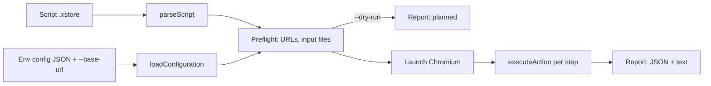

# Technical Overview

> Source of truth: `docs/wiki/Technical-Overview.md` in
> [axp307/xstore-playwright](https://github.com/axp307/xstore-playwright).
> Keep the GitHub Wiki copy synchronized with this file as the framework evolves.

## 1. Purpose

A standalone TypeScript + Playwright runner that executes human-readable,
deterministic test scripts against Oracle Retail Xstore POS (localhost now,
remote test servers later). No LLM or natural-language guessing at runtime: a
fixed vocabulary of step patterns maps to Playwright actions.

Goals: watchable (headed browser, `slowMo`), reproducible, and ending with a
report of each step's status and duration plus a total.

> **Integration boundary:** the runner and mock workflow are verified. The
> cash-sale selectors are **illustrative and unverified** against a real
> Xstore/Sherwin-Williams deployment. They must be mapped to the actual web UI
> before running a real sale. The shell smoke flow was verified live (section 10).
> Native/desktop Xstore screens are out of scope.

## 2. Architecture

| File | Responsibility |
| --- | --- |
| `src/cli.ts` | Argument parsing (`--script`, `--config`, `--base-url`, `--dry-run`, `--headless`, `--slow-mo`, `--report-dir`), exit code |
| `src/parser.ts` | Script text -> `Step[]` (`Action` union); syntax errors with line numbers |
| `src/config.ts` | Environment config loading/validation, `defaultSelectors`, URL validation, JSON input helpers |
| `src/runner.ts` | Preflight, browser lifecycle, step loop, timing, redaction, report writing |
| `src/xstore.ts` | `executeAction` (Playwright actions per keyword), `exactCashAmount` |
| `examples/` | Sample script and example input files |
| `config/localhost.example.json` | Example environment config |
| `tests/` | Unit tests and mock-app Chromium integration tests |



## 3. Workflow: how input is interpreted

1. **CLI** loads the environment configuration (`loadConfiguration`). The
   `--base-url` flag overrides `baseUrl` in the file; default
   `http://localhost:8080`.
2. **Parse** (`parseScript`): each non-blank, non-`#` line has an optional
   `N. ` prefix stripped, then must match one anchored, case-insensitive
   pattern. Unknown lines throw `Line N: unknown step` **before any browser
   action**. The script must contain steps and the first must be `Open app at`.
3. **Preflight** (`runScript`, before any browser): validates `Open app` URLs;
   reads every referenced input file (paths relative to the script), checks
   shape (credentials: exactly `username` + `password`; configuration: non-empty
   and every key has a field selector in `configurationFields`). Loaded values
   are collected for redaction. Preflight failures throw, exit nonzero, and
   write **no** report.
4. **Dry run** (`--dry-run`): marks every step `planned`, writes a report, never
   launches a browser or contacts Xstore. A dry-run "passed" means preflight
   succeeded, not that the UI works.
5. **Live run**: launches Chromium (headed by default, `slowMo` default 250 ms),
   sets default and navigation timeouts to `timeoutMs`, and executes steps
   sequentially. Console shows `[running]` / `[passed|skipped|failed]` with
   durations live.
6. **Failure handling**: the first failed step records its (redacted) error,
   stops execution, leaves later steps `not-run`, and the process exits 1.
   Browser start/navigation/cleanup errors also yield a failed report.
7. **Report**: `reports/run-<timestamp>-<id>.json` and `.txt` (git-ignored,
   mode `0600`) with status, start/finish, total ms, and per-step line, text,
   status, duration, error. Durations use a monotonic clock and are reported in seconds with up to 3 decimals (config settings stay in milliseconds). Each step records `durationSec` (elapsed) = `executionSec` (action time, includes `--slow-mo`, excludes both delays) + `humanDelaySec` (measured `humanDelayMs` pauses before clicks/fills/key presses; 0 when disabled) + `observationDelaySec` (measured `stepDelayMs` pause; 0 for dry-run/skipped/failed/not-run). The run records `stepExecutionSec`, `stepHumanDelaySec` and `stepObservationDelaySec` sums; the terminal step lines and final summary print the same fields (elapsed = execution + human delay + observation delay; wall-clock total includes startup/cleanup overhead); total includes
   browser startup/cleanup.

Statuses: `planned`, `passed`, `skipped` (conditional step not needed),
`failed`, `not-run`.

## 4. Prerequisites and running on your device

- Node.js **22+** and npm
- Network access to download Playwright's Chromium (one-time)
- A reachable Xstore web endpoint (not needed for dry-run or mock tests)

```sh
npm ci                          # or: npm install
npx playwright install chromium
npm run typecheck
npm test                        # parser, config, cash parsing, dry-run
npm run test:browser            # real Chromium against a local mock app
HEADED=1 npm run test:browser   # watch the mock run in a visible browser
npm run dry-run                 # validate the example script/inputs only
npm run build                   # emits dist/; CLI: node dist/src/cli.js
```

Run against **localhost**:

```sh
npm start -- --script examples/cash-sale.xstore \
  --config config/localhost.example.json --base-url http://localhost:8080 --slow-mo 500
```

Run against a **remote test server** (same script, different environment):

```sh
cp config/localhost.example.json config/remote.local.json   # ignored by git
npm start -- --script examples/cash-sale.xstore \
  --config config/remote.local.json --base-url https://pos-test.example.com
```

Flags: `--dry-run`, `--headless` (CI), `--slow-mo <ms>` (`0` = full speed),
`--report-dir <dir>`, `--help`.

> **Safety:** a real run completes a cash sale and changes POS state, with no
> rollback or retry. Use a test store/register and test data; never target
> production by accident. Dry-run first.

## 5. Writing a new script

Create a `.xstore` text file. One step per line; blank lines and whole-line `#`
comments are ignored; `1.` numbering is cosmetic (reports use source line
numbers). Keywords are case-insensitive; quoted paths/URLs and product IDs keep
their exact content.

```text
# examples/cash-sale.xstore
1. Open app at "/"
2. Use first-time configuration from "configuration.example.json" if prompted
3. Log in using "credentials.example.json"
4. Go to Start Transaction
5. Start a sale as a DIY Customer
6. Add products 650921315, 651234940
7. Check out with cash using the exact amount due
```

### Supported keywords (complete vocabulary)

| Step | Action |
| --- | --- |
| `Open app at "URL-or-path"` | Navigate (relative to base URL; absolute HTTP(S) bypasses it); fails on non-OK HTTP. Must be first. |
| `Use first-time configuration from "file" if prompted` | Conditional: waits for setup, login, or start-transaction screen; fills fields and submits only if the setup screen is visible, else `skipped` |
| `Log in using "file"` | Fills username/password, submits, waits for the Start Transaction control. Never skipped. |
| `Go to Start Transaction` | Clicks the start-transaction control |
| `Start a sale as a DIY Customer` | Clicks Sale, then DIY Customer |
| `Add products <id>[, <id>...]` | Per ID: fills, adds, then waits for the cart line count to increase. Leading zeros and repeats preserved. |
| `Check out with cash using the exact amount due` | Checkout -> Cash -> reads amount due -> enters exact amount -> completes -> waits for completion marker |
| `Log in at the Xstore login screen using "file"` | Types the user ID in the focus bar, Enter, types the password in the password dialog, Enter, waits for the Main Menu (Log Out button). Xstore shows Start Transaction before sign-on, so this must come before starting a sale. File: exactly `username` and `password`; not redacted in reports (shared developer login). |
| `Click on "Start Transaction"` | Clicks the Main Menu Start Transaction card and waits for Customer Lookup |
| `Skip customer lookup` | Clicks Skip and waits for the Shopping Cart scan field |
| `Scan sale items from "file"` | Per item in the file, repeated `quantity` times (each unit is a separate scan; Xstore treats repeats as a quantity change): types the sale ID in the scan field, presses Enter, waits for the cart to gain a line or for the existing line showing that exact sale ID (whole token, so `123` never matches `91234`) to change. The `saleLineQuantity` selector (Playwright syntax resolved inside the line; default `#row2 > div:nth-child(5)`, verified on Xstore 24.0) must show a higher quantity; if it is empty or unreadable, any text change on that line counts |
| `Scan sale items from "file" and record scan times for each item` | Same, and times each item from sale ID entry until the cart updates. Logs `[scan-time] item XXX took YYY seconds to complete scanning` to the console and text report; also stored in the JSON report as `scanTimes` |
| `Click on "Amount Due"` | Clicks the Amount Due button and waits for the Payment Options |
| `Note the amount due and click on "Cash"` | Records the Payment Options amount due, then clicks the Cash tender card |
| `Enter the exact amount due and press Enter` | Types the noted amount on the (read-only) tender keypad field, checks the field shows it, presses Enter |
| `Wait for the Customer Lookup or Main Menu screen` | Waits for the tender dialog to close and Customer Lookup (or the Main Menu Log Out button) to show |

### DIY Sale with Cash

`diy-sale/diy-sale-with-cash.xstore` completes a no-account cash sale. Run it
against an authorized test instance:

```sh
npm start -- --script diy-sale/diy-sale-with-cash.xstore \
  --config config/localhost-shell.json --slow-mo 400 --report-dir reports/live
```

Items come from `diy-sale/sale-items.json`:
`{"items": [{"saleId": "650427503", "quantity": 1}, ...]}`. `quantity` is
applied by scanning the sale ID once per unit (Xstore treats repeats as a
quantity change); with `record scan times`, each scan gets its own timing
entry. Xstore keeps
transaction state server-side, so a failed run can leave a sale open or the
cashier signed in; cancel the sale and log out before rerunning (step 4 expects
the login screen). Login uses the generic developer login in
`config/xstore-login.json`. This script has been verified live through
Login -> Main Menu -> Customer Lookup -> Shopping Cart -> Payment Options -> Cash tender -> back to Customer Lookup.

Restrictions: paths must be double-quoted; no inline comments, escaped quotes,
multiline steps, interpolation, or embedded code.

### External input files

Paths inside a script resolve relative to the **script's directory**; CLI paths
resolve relative to the current directory. Files contain JSON (even if named
`.txt`).

Credentials (exactly these two non-empty strings):

```json
{ "username": "your-test-user", "password": "your-test-password" }
```

First-time configuration (non-empty strings keyed by `configurationFields`):

```json
{ "storeId": "123", "registerId": "1" }
```

Keep real values out of git: use the ignored `secrets/`, `*.local.txt`, or
`config/*.local.json`. Committed `examples/*.example.json` hold demo values
only. Loaded values are redacted from persisted step text and errors. Failure
screenshots mask editable fields, configured credential/configuration fields,
and shell inputs, and are saved with POSIX mode `0600`. Screenshot capture/write
is best-effort and does not replace the original failure. Reports and screenshots
can still expose URLs, paths, UI text, and data outside masked fields; keep them private.

## 6. Environment configuration

`config/localhost.example.json` (unknown keys are rejected):

| Key | Meaning | Default |
| --- | --- | --- |
| `baseUrl` | HTTP(S) origin; no embedded credentials | `http://localhost:8080` |
| `timeoutMs` | Positive integer timeout for actions/navigation | `15000` |
| `humanDelayMs` | Pause in ms before every human action (click, fill, key press) to simulate a person using the POS, randomized uniformly by ±25% per action; `0` disables. Applies per action, unlike `stepDelayMs` (per step) | `0` |
| `timesInSeconds` | Display only: `true` prints times in seconds (`1.45 s`) in the console and text report; `false` prints milliseconds (`1450 ms`). The JSON report always stays in seconds (`*Sec` fields) | `true` |
| `stepDelayMs` | Observation pause in ms after each passed step (incl. the last); `0` disables. Counted in step/total timing; distinct from `--slow-mo` (per browser operation); not used for dry-run/skipped/failed steps | `0` |
| `ignoreHttpsErrors` | Opt-in: accept a trusted self-signed HTTPS certificate for the run's context only | `false` |
| `browserState` | Browser state per run. Only `"fresh"` (new isolated context) is supported; other values are rejected | `"fresh"` |
| `selectors` | Overrides for named selectors (see below) | `defaultSelectors` |
| `configurationFields` | Config-file key -> field selector | `storeId`, `registerId` inputs |
| `amountFormat` | `decimalSeparator`, `groupSeparator`, `currencySymbol` | `.`, `,`, `$` |

Cash amounts are parsed as strings (no floating point): optional currency symbol
at either end, three-digit grouping, up to two decimals, e.g. `$1,234.56` ->
`1234.56`. Ambiguous text (labels, negatives, 3 decimals) is rejected. For
other locales set `amountFormat`.

## 7. Xstore selectors and integration boundaries

All selectors are centralized in `defaultSelectors` (`src/config.ts`) and
overridable per environment via `selectors` (Playwright selector strings; unique
and stable ones recommended — ambiguous matches fail rather than guess).

Names: `configurationScreen`, `configurationSubmit`, `username`, `password`,
`loginSubmit`, `startTransaction`, `startSale`, `diyCustomer`, `productId`,
`addProduct`, `cartItems`, `checkout`, `cash`, `amountDue`, `cashAmount`,
`completeTransaction`, `transactionComplete`.

Known assumptions to validate against the real deployment:

- Flow is Sale -> DIY Customer -> scan -> Checkout -> Cash -> amount -> Complete.
- `configurationScreen` identifies only the setup panel; `username` and
  `startTransaction` identify the alternative ready screens.
- `cartItems` matches one element per scanned line; systems that merge repeated
  scans into a quantity row need an adjusted assertion in `src/xstore.ts`.
- `amountDue` selects only the numeric balance.
- `transactionComplete` is a reliable success marker.
- Extra prompts (customer lookup, receipts, tax dialogs, store-specific login)
  need explicit new actions.

Deployment-specific customization source may help find screen labels.

To re-discover the quantity cell after a UI change, run `npx tsx tools/discover-quantity-dom.ts` (test instance only): it scans the first sale item twice and prints the DOM nodes that changed. It leaves the sale open, so cancel it before the next DIY sale run.
Cash-sale selectors have **not** been verified against a running Xstore.

## 8. Adding a new keyword

1. Add a variant to the `Action` union in `src/parser.ts`.
2. Add an anchored pattern branch in `parseScript` returning that action.
3. Implement it in `executeAction` (`src/xstore.ts`); wait on explicit UI
   conditions, not fixed sleeps. Return `"skipped"` only for bounded
   conditionals with known screen markers.
4. Add any new selector to `defaultSelectors` (and the README/this page).
5. If it takes an input file, extend preflight in `src/runner.ts`.
6. Add parser tests (`tests/framework.test.ts`) and a mock-flow case
   (`tests/browser.integration.ts`) if behaviour is observable.
7. Update the syntax table above.

## 9. Testing

- `npm test`: parsing, rejection of malformed syntax, cash parsing, config
  validation, dry-run reports, and preflight/redaction errors.
- `npm run test:browser`: real Chromium vs. a local HTTP mock: setup
  present/absent, login, scans, exact tender, completion, and fail-fast reports
  (rejected product, login failure with redaction, HTTP error). This proves the
  runner, not compatibility with an unobserved Xstore deployment.

## 10. Smoke test: "Xstore is running" (live-verified shell flow)

`smoke/xstore-is-running.xstore` + `config/localhost-shell.json` +
`smoke/shell-configuration.json` verify the shell app reaches the real Xstore
login screen (no login, no sale). Run:

```sh
npm start -- --script smoke/xstore-is-running.xstore --config config/localhost-shell.json --slow-mo 400 --report-dir reports/live
```

Keywords added: `Use Xstore shell configuration from "file" if prompted`
(`shellConfigure`: Location Details, Connection Details, requires an exact
Success label in the Test Connection dialog, saves, Launch Xstore; skipped if the setup screen is
absent), `Dismiss the device error prompt if shown` (`dismissDeviceError`, OK on
a "Hardware Error" dialog if present) and `Wait for the Xstore login screen`
(`expectLogin`, requires the login form ready and hardware dialog hidden or
absent, including dialogs retained in the DOM). The shell file needs exactly `store`, `register`, `host`,
`port` (strings, port 1-65535; not redacted since they are not secrets).

Config: `ignoreHttpsErrors` (default `false`) sets Playwright's
`ignoreHTTPSErrors` on the fresh context only, to trust localhost's
self-signed certificate; no browser/system trust changes. Failures (service
down, failed connection test, unknown screen, no login) are failed runs with a
saved report and a per-step failure screenshot (`<run>-line-N.png`).

Selectors for these screens (`shell*`, `deviceError*`, `loginReady`) were taken
from the live app on 2026-11-16 (e.g. `#configMain`, `[id="storeNumber|input"]`,
`oj-dialog`, `#focusBarInfoArea`). Observed behavior: the "Hardware Error"
(barcode scanner) dialog appeared in some launches and not others, and one
headed run timed out waiting for the setup screen (cause not determined), so
treat timing as variable. Cash-sale selectors remain unverified.

## 11. Roadmap / open questions (edit as the project matures)

- Map and verify selectors against a live Xstore test environment.
- Additional keywords (returns, other tenders, voids, assertions).
- Screenshots/traces on failure; retries; per-step timing aggregates.
- Persistent browser profile as a new `browserState` value (extension point: `newContext()` in `src/runner.ts`).
- Remote-server environment configs and CI usage.
- Keep the GitHub Wiki synchronized with this version-controlled page.
